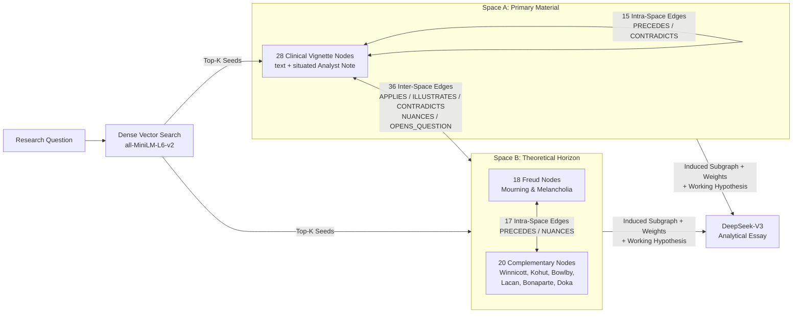

# Hermeneutic GraphRAG Lab
### Prolegomena to Epistemic Routing in Humanities Research

> *A small-scale, zero-framework learning experiment exploring how chunks, nodes, weighted edges, and bounded theoretical corpora interact when a humanities researcher maps an interpretive horizon in front of a Large Language Model.*

---

## 1. Why This Exists (A Humble Note on Scope)

Most GraphRAG architectures are engineered for industrial scale: extracting millions of factual triples from corporate or scientific repositories to retrieve unambiguous answers. **Humanities inquiry works very differently.** A research project in literary studies, psychoanalysis, art theory, or cultural studies may involve only two books and a single working hypothesis—yet the epistemic weight of each passage, the nature of the links connecting them, and the strict boundaries of the theoretical corpus are decisive.

Before attempting to use a knowledge graph as a real methodological instrument for humanities research, **I needed to learn how the mechanism actually works under the hood.** 

This repository claims to prove nothing. It is not a software product, nor a finished academic thesis, nor a benchmark. It is a **humble prolegomenon**: a hands-on laboratory built strictly to understand the technical mechanics through which textual chunks, vector embeddings, nodes, and typed edges are constructed and interact during generation. Making these mechanics explicit is a first step toward making conscious—and eventually experimental—the hermeneutic paths we already follow silently as humanists.

---

## 2. Provenance & Transparency

In the spirit of open laboratory notes, the genealogy of this repository is straightforward:

1. **First Iteration (Spanish, Private Corpus):** The initial experiment was designed and built in Spanish alongside **Claude Sonnet 4.6**. The iterative dialogue that produced the graph architecture, chunking strategy, ontology design, retrieval logic, and pipeline debugging — including two failed installation attempts and several corpus corrections — was conducted entirely within a single Claude Sonnet 4.6 conversation, pairing psychoanalytic theory (*Mourning and Melancholia* plus a secondary theoretical synthesis on companion-animal bereavement) with a personal, autobiographical text. The goal was to learn GraphRAG mechanics using deeply familiar material where interpretive nuances could be judged immediately.
2. **Public Lab Adaptation (English, Fictionalized Vignette):** To share the code and findings on GitHub without exposing private biographical writing, the primary narrative was completely re-imagined and rewritten in English as a **synthetic clinical vignette** (*"Argo and I"*: the story of Clara, a British archivist in Bristol and Dartmoor, mourning her father Walter alongside her Lurcher, Argo) while preserving the exact topological structure ($1:1$ node and edge equivalence) of the original graph. **Gemini Carbon** audited and refactored the Python pipeline, resolved silent graph-overwrite bugs, operationalized multi-hop epistemic rules, and guided the bilingual transformation.
3. **Analytical Synthesis Engine:** All generative tests and A/B comparisons were executed via the **DeepSeek API** (`deepseek-chat` / DeepSeek-V3).

---

## 3. Architecture & Epistemic Design

Rather than delegating graph extraction to an LLM, every node, analytical note, edge justification, and weight in `data/` was **authored manually** under a single source of truth (`data/ontology.json`).



### Key Methodological Choices

* **Dual-Space Topology (66 nodes, 68 directed edges):** Separates primary material under interpretation (`space_A`) from the bounded theoretical lens (`space_B`).
* **Deliberately Biased Vectors:** In `02_embed_nodes.py`, each passage's raw text is concatenated with `[Analyst Note]` prior to L2-normalized embedding. Because unit-norm vectors satisfy $\cos(\theta) = u \cdot v$, cosine retrieval is intentionally steered toward the researcher's situated reading rather than pretending to be a neutral index.
* **Assertive vs. Hermeneutic Edges:** Alongside knowledge and narrative edges (`APPLIES_CONCEPT`, `ILLUSTRATES`, `CONTRADICTS`, `NUANCES`, `PRECEDES`), the ontology defines `OPENS_QUESTION` (`epistemic_type: "hermeneutic"`, `propagate_embeddings: false`). During multi-hop retrieval (`03_retrieval.py`), `OPENS_QUESTION` pulls in its immediate neighbor to stage an unresolved tension for the LLM, but halts transitive propagation—treating open questions as hermeneutic boundaries rather than deductive premises.
* **Working Hypothesis Injection:** `04_generate.py` dynamically reads `central_hypothesis` from `data/ontology.json`, instructing DeepSeek to test, qualify, and strain the hypothesis rather than issue a closed clinical diagnosis.

---

## 4. Technology Stack (Zero-Bloat)

No LangChain, LlamaIndex, or Neo4j overhead—just inspectable data structures and linear algebra running on CPU:

| Component | Technology | Role |
| :--- | :--- | :--- |
| **Environment** | Linux (openSUSE Tumbleweed), Python 3 | Local CPU execution (`venv`) |
| **Graph Engine** | `networkx` (`DiGraph`) | Dual-space topology, schema validation, and multi-hop BFS |
| **Embeddings** | `sentence-transformers` (`all-MiniLM-L6-v2`) | 384-dimensional L2-normalized dense vectors (~90 MB) |
| **Vector Math** | `numpy` | Exact cosine similarity via matrix-vector dot product (`embeddings @ query_vec`) |
| **LLM Synthesis** | DeepSeek API (`deepseek-chat`, `temp=0.3`) | Direct HTTP calls via `requests` + `python-dotenv` |

---

## 5. Observations from Testing

To evaluate what the graph actually changes, identical research questions were run against two setups:

* **Control Baseline (`05_baseline_no_rag.py`):** Feeds only the full raw narrative of Clara and Argo to DeepSeek, relying on the model's pre-trained psychoanalytic knowledge.
* **Hermeneutic GraphRAG (`04_generate.py`):** Feeds only the retrieved dual-space subgraph, edge justifications, weights, and working hypothesis.

### A. Baseline (No-RAG) vs. GraphRAG

* **Theoretical Discipline:** Without RAG, DeepSeek writes fluently and perceptively, yet falls back on generic psychoanalytic commonplaces (e.g., framing Clara through a deficit psychology of "a self that cannot self-soothe" or quickly dismissing melancholia as a practical matter of "adders, poison, and sheep country"). With GraphRAG, the model operates strictly within the chosen bibliographic horizon—triangulating Freud's translation of Marie Bonaparte's *Topsy*, Doka's disenfranchised grief, Klass et al.'s continuing bonds, Kohut's selfobject, and Lacanian non-substitutability.
* **Sustaining Open Tensions:** Where the baseline tends toward neat interpretive closure, the GraphRAG pipeline obeys `CONTRADICTS` and `OPENS_QUESTION` edges—preserving the ambiguity between melancholic self-reproach and genuine ethical concern for non-human autonomy, and distinguishing repressed loss from socially unformulated loss.

### B. The `--top-k 5` vs. `--top-k 8` Retrieval Lesson

When asking: *"How are Clara's compulsive street muttering in Bristol and her inability to sleep or eat during Argo's disappearances on Dartmoor structurally connected?"*, inspecting the retrieval trace revealed a crucial mechanical lesson:

* **At `--top-k 5` (default):** Because the query spanned multiple locations and concepts, node `argo_21` (where Clara explicitly recounts not sleeping or eating during Argo's 48-hour disappearances) scored `0.365`—missing the Top-5 semantic cut at Rank #6! Because no intra-space edge directly linked `argo_03` (muttering) to `argo_21` (insomnia/fasting), 1-hop expansion could not rescue it either. DeepSeek remained philologically honest (*"The passages supplied do not narrate the disappearances directly..."*) and inferred the structure indirectly through `argo_27`.
* **At `--top-k 8`:** Node `argo_21` (`0.365`) entered at Rank #6, immediately pulling `theory_06` (Kohutian selfobject fragmentation) and `theory_13` (autonomic/sympathetic dysregulation) across the 1-hop bridge (28 nodes, 37 edges total). Grounded in both somatic endpoints, DeepSeek formulated a much sharper structural thesis: a conservation of psychic pressure running in opposite directions (hyper-verbal expulsion in Bristol when the interlocutor is bitter/withdrawn vs. silent incorporative shutdown on Dartmoor when the regulating mediator vanishes).
* **Takeaway:** In small humanistic graphs, semantic top-k thresholds and missing intra-space links directly determine what empirical evidence reaches consciousness. Topology is destiny.

---

## 6. Critical Reflection: The Epistemic Fence & The Loss of "Spark"

One of the most important findings of this exercise is negative—or at least ambivalent.

Enclosing the LLM inside strict GraphRAG boundaries cuts both ways:

* **It restricts for the better:** It prevents hallucination, stops theoretical drift, enforces fidelity to specific textual citations, and keeps the model honest about what the evidence does and does not support.
* **It restricts for the worse:** Confined strictly to the retrieved subgraph and edge justifications, the model noticeably loses part of its associative "spark." In open or baseline mode, a frontier model occasionally surprises the reader with an unexpected metaphor, a lateral bridge to broader literary or cultural history, or an unprompted intuition. Inside the RAG fence, the prose becomes more disciplined and rigorous, yet somewhat tamer—dutifully pacing the perimeter of the researcher's pre-drawn map.

For humanities research—where rigor and associative brilliance are both essential—this trade-off between epistemic containment and creative lateral freedom is not trivial. How to let an LLM traverse a strict hermeneutic graph without extinguishing its wider cultural and essayistic spark will be a central focus of upcoming experiments.

---

## 7. Next Steps (Future Labs)

* **Dynamic Topographical Perturbation:** Build an interactive iteration where nodes, edge types, and weights can be altered, rewired, or ablated on the fly (e.g., flipping an `APPLIES_CONCEPT` edge to `CONTRADICTS`, or removing an entire school from Space B) to systematically observe how the LLM's reasoning mutates in response to shifts in the researcher's hermeneutic map.
* **Controlled Porosity ("Spark" Recovery):** Experiment with two-stage or hybrid prompting architectures that preserve strict graph grounding for textual claims while allowing controlled associative aperture toward broader cultural and philosophical references.

---

## 8. Repository Structure & Quickstart

```text
.
├── 01_build_graph.py       # Builds & validates the dual-space DiGraph against ontology.json
├── 02_embed_nodes.py       # Concatenates text + Analyst Notes and saves L2-normalized vectors
├── 03_retrieval.py         # Hybrid cosine seed search + weight/ontology-aware BFS expansion
├── 04_generate.py          # End-to-end GraphRAG synthesis via DeepSeek API (CLI & interactive)
├── 05_baseline_no_rag.py   # Control script (raw story only, no graph) for A/B comparison
├── data/
│   ├── ontology.json       # Single source of truth: spaces, tags, edge rules, working hypothesis
│   ├── nodes.json          # Space A: 28 synthetic clinical vignette nodes ("Argo and I")
│   ├── nodes_freud.json    # Space B: 18 nodes from Freud's "Mourning and Melancholia" (1917)
│   ├── nodes_theory.json   # Space B: 20 complementary theoretical nodes
│   ├── edges.json          # 36 inter-space interpretive edges (Space A -> Space B)
│   └── edges_intra.json    # 32 intra-space causal & conceptual edges
├── .env.example            # Environment variable template
└── requirements.txt
```

### Setup & Run (Linux / macOS)

```bash
# 1. Create and activate virtual environment
python3 -m venv .venv
source .venv/bin/activate

# 2. Optional (Linux CPU-only): avoid downloading heavy CUDA wheels
pip install torch --index-url https://download.pytorch.org/whl/cpu

# 3. Install dependencies
pip install -r requirements.txt

# 4. Configure your DeepSeek API key
cp .env.example .env
# Edit .env and set DEEPSEEK_API_KEY=sk-...

# 5. Validate ontology/graph and build embeddings
python 01_build_graph.py
python 02_embed_nodes.py

# 6. Run a GraphRAG query (with custom top-k or hops)
python 04_generate.py "How are Clara's compulsive street muttering in Bristol and her inability to sleep or eat during Argo's disappearances on Dartmoor structurally connected?" --top-k 8 --hops 1

# 7. Run the No-GraphRAG baseline for comparison
python 05_baseline_no_rag.py "How are Clara's compulsive street muttering in Bristol and her inability to sleep or eat during Argo's disappearances on Dartmoor structurally connected?"
```
